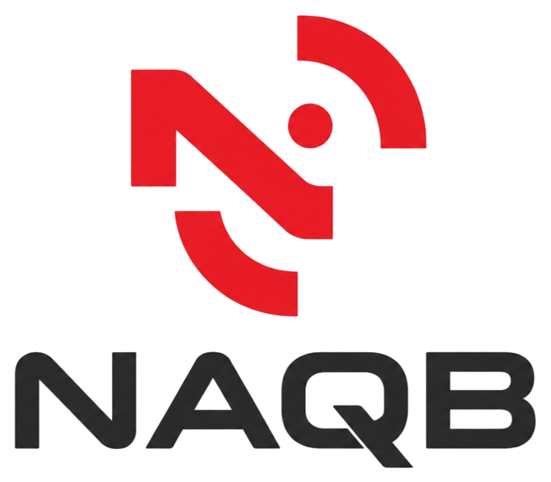

<!-- Add the official naqb-logo.png here:   -->

# NAQB

Scan runner and result collector (PTES: pre-engagement, intelligence gathering, vulnerability-analysis *results only*).
Codebase name: PentestPilot. This release stops at scanner results; see the scope brief.

## Layout

| Path | What |
|---|---|
| `packages/shared` | TypeScript: scope check, tool registry (pinned images, argument lists), 7 parsers, tests |
| `apps/worker` | Node.js worker: claims jobs, checks scope, runs each tool in a throwaway container, parses, upserts |
| `apps/web` | React + Vite + Tailwind v4 + TanStack Query app |
| `supabase/migrations` | Schema, RLS, grants, job-queue function, Realtime |
| `supabase/tests` | Three-account RLS test (Team Lead / member / non-member) |

## Set up

1. Create a Supabase project, run `supabase/migrations/0001_init.sql`. In Auth settings, enable email sign-in.
2. Copy `.env.example` to `.env` and fill it in. The **secret key** is for the worker only.
3. Put the official logo files in `apps/web/public/`: `naqb-logo.png`, `naqb-logo-dark.png`, `naqb-mark-512.png`, `naqb-favicon-32.png`, `naqb-apple-touch-180.png`.
4. `npm install && npm run build:shared`
5. Web: `npm run web`. Tests: `npm test`.
6. Make the first Team Lead in the SQL editor: `update profiles set role='team_lead' where email='you@…';`
7. **Lab machine only:** `docker network create --internal naqb-lab`, attach the lab targets (Juice Shop, crAPI), then `npm run worker`
   (or `docker compose up worker`). The worker uses the Docker socket, which is root on the host.
8. Build the two custom images (`naqb/enum4linux-ng`, `naqb/ftp-scan`) and run `docker pull` for every tag in `packages/shared/src/tools.ts`; fix any tag that does not exist.

## Security design

- Scope is checked by the **worker** before every scan (`isInScope`, fails closed); rejections go to `audit_log`.
- Targets are validated against a strict character set and passed to `docker run` as an argument list, no shell.
- Containers: `--rm`, memory/CPU/pids caps, all capabilities dropped, read-only filesystem, timeout, output-size cap, lab-only network.
- RLS enforces every row of the permission table; users can only update `scan_jobs.cancel_requested` and `profiles.role`.
- Tool output is rendered as plain text. Results are never labelled "confirmed".

## Tool status (tested in the lab, 2026-11-17)

| Tool | Image | Status |
|---|---|---|
| Nmap | `instrumentisto/nmap:7.95` | Works. Real output in fixtures. |
| Subfinder | `projectdiscovery/subfinder:v2.6.7` | Works. Passive only; runs on the `bridge` network because it must query public sources. |
| Gobuster | `ghcr.io/oj/gobuster@sha256:e5fb10a1…` (v3.8.2; the registry only publishes `latest`, so it is pinned by digest) | Works. Retries automatically ignoring the catch-all page length of single-page apps. |
| Nuclei | `projectdiscovery/nuclei:v3.11.1` | Works. Templates live in the `naqb-nuclei-templates` volume (see below). |
| Nikto | `ghcr.io/sullo/nikto:2.6.1` (2.6.0 does not exist on the registry) | Works. A connection failure is a failed job, not a finding. |
| FTP-Scan | `naqb/ftp-scan:0.1.0` (`docker/ftp-scan`, written for this project) | Works against the lab vsftpd. |
| Enum4Linux-NG | `naqb/enum4linux-ng:1.3.4` (`docker/enum4linux-ng`) | **Not built.** Package downloads are cut off on the dev machine's network. Build it on another network. Its parser still uses a hand-written fixture. |

Nuclei templates (needs a network where GitHub TLS works, or download the tarball by hand):
`curl -sL https://github.com/projectdiscovery/nuclei-templates/archive/refs/heads/main.tar.gz | docker run --rm -i -v naqb-nuclei-templates:/t alpine tar xz -C /t --strip-components=1`

Lab: `docker compose -f lab/docker-compose.yml up -d` (Juice Shop 10.10.0.5, vsftpd 10.10.0.6, Samba 10.10.0.7 on the internal `naqb-lab` network).

## Targets

Testers can type an IP, range, domain, URL or host:port for any tool; `adaptTarget` converts it to what the tool needs
(URL tools get `http(s)://host[:port]`, host tools get a bare host, Subfinder needs a domain, only Nmap takes a range).
The worker does this itself, so the API behaves the same as the UI.

## Known gaps

- Enum4Linux-NG image not built (see above), so brief check #1 is 6 of 7.
- Checks #2 to #5 were verified for the six working tools by comparing raw output with stored results; this found and fixed
  three parser bugs (Subfinder sources, Nuclei matchers, Nikto repeated ids). Check #8 (timeout) and #6 (direct API) are not yet exercised against a running worker beyond scope rejection.
- The FTP-Scan JSON schema is our own; its exploit table is a tiny local list.
- Redis is not used: the queue is Postgres (`FOR UPDATE SKIP LOCKED`) and live output goes through a Realtime-enabled table. Raw output is stored in `scan_jobs.raw_output`, not Storage.
- shadcn/ui is not installed; components are plain Tailwind. No browser end-to-end script yet, and the console-clean check (#10) is unverified.
